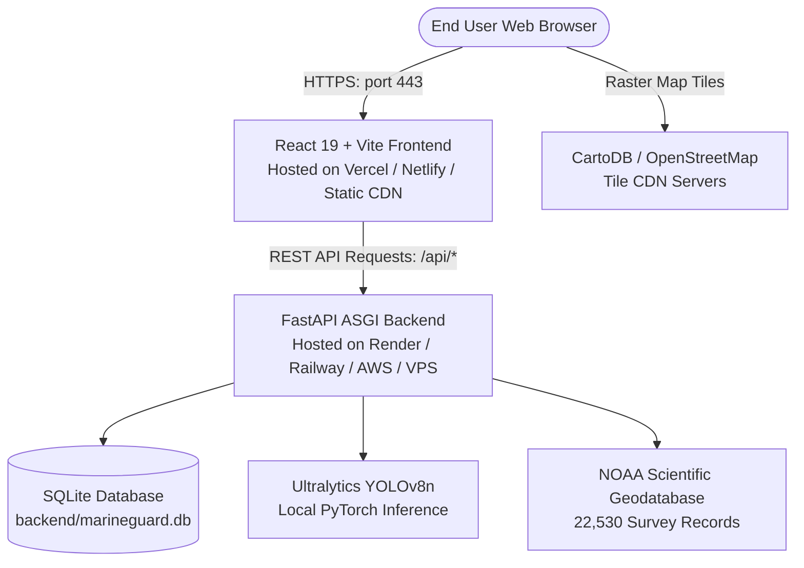

# MarineGuard AI – Comprehensive API & Deployment Configuration Guide

## Executive Summary & Audit Result

An exhaustive audit of the **AI-Based Marine Plastic Pollution Tracking System** (`MarineGuard AI`) codebase reveals that **the application does NOT require any external commercial API keys, third-party subscriptions, or paid cloud tokens to operate fully.**

The system is architected as a self-contained, privacy-preserving, and offline-capable platform:
1. **Interactive Map**: Implemented with **Leaflet 1.9.4** using public tile layers (**CartoDB Dark Matter** and **OpenStreetMap**). Neither requires a personal API key. (Support for optional commercial providers such as Mapbox is also built in if desired).
2. **AI Computer Vision Model**: Uses **Ultralytics YOLOv8n** running locally via PyTorch and OpenCV. All model inference occurs locally on your machine or server CPU/GPU. No OpenAI, HuggingFace, or Roboflow API keys are used.
3. **Geospatial Clustering**: Uses **scikit-learn DBSCAN** with a Haversine spherical distance metric locally in memory.
4. **NOAA Dataset**: 22,530 validated microplastic records are stored in a local SQLite database (`backend/marineguard.db`) and seeded from `backend/data/noaa_marine_microplastics.csv`. No external dataset API is queried at runtime.
5. **Geocoding / Reverse Geocoding**: **None is used**. The system operates directly on geographic WGS 84 latitude and longitude coordinates.
6. **PDF Reports**: Generated on the backend using the open-source **ReportLab** library without external document rendering services.

---

## 1. Complete API & External Service Audit Table

| Feature / Module | Actual Service or API Used | API Key Required? | Official Website to Obtain Key | Exact Environment Variable Name | Exact File / Configuration Where Consumed | Public or Secret? | Pricing, Tier & Usage Limits | Local & Production Configuration Steps |
| :--- | :--- | :---: | :--- | :--- | :--- | :---: | :--- | :--- |
| **Interactive Map (Primary Dark Basemap)** | Leaflet 1.9.4 with CartoDB Dark Matter Raster Tiles | **NO** | [https://carto.com/](https://carto.com/) | N/A *(Optional override: `VITE_MAP_TILE_URL`)* | [`frontend/src/components/MapComponent.tsx`](file:///frontend/src/components/MapComponent.tsx#L28-L108) | **Public** (Client-side) | **100% Free** for open web use with standard Carto attribution. No key or account required. | **Local**: Preconfigured default. No setup needed.<br>**Production**: Works automatically without extra configuration. |
| **Interactive Map (Street Map Toggle)** | OpenStreetMap (OSM) Standard Tile Layer | **NO** | [https://www.openstreetmap.org/](https://www.openstreetmap.org/) | N/A | [`frontend/src/components/MapComponent.tsx`](file:///frontend/src/components/MapComponent.tsx#L285-L315) | **Public** (Client-side) | **100% Free** public service under OSM Foundation Tile Usage Policy (reasonable non-bulk web viewing). | **Local**: Active in map layer switch button.<br>**Production**: Works automatically. Do not use for automated bulk tile scraping. |
| **Optional Map Provider (Mapbox / Stadia)** | Mapbox Styles API / Stadia Maps *(Optional alternative)* | **YES** *(Only if explicitly chosen over Carto/OSM)* | [https://www.mapbox.com/](https://www.mapbox.com/) or [https://stadiamaps.com/](https://stadiamaps.com/) | `VITE_MAP_TILE_URL`<br>`VITE_MAP_ATTRIBUTION` | [`frontend/src/components/MapComponent.tsx`](file:///frontend/src/components/MapComponent.tsx#L30-L105) | **Public** (Client-side access token) | **Free tier**: Mapbox provides 50,000 free map loads/mo. Stadia provides 200,000 tile requests/mo. | **Local & Production**:<br>1. Create account on Mapbox/Stadia.<br>2. Add to `.env`: `VITE_MAP_TILE_URL=https://api.mapbox.com/styles/v1/mapbox/dark-v11/tiles/{z}/{x}/{y}?access_token=YOUR_TOKEN`<br>3. Restrict token to your domain in Mapbox dashboard. |
| **AI Plastic Detection & Localization** | Ultralytics YOLOv8n (`yolov8n.pt`, PyTorch, OpenCV) | **NO** | [https://docs.ultralytics.com/](https://docs.ultralytics.com/) | `YOLO_MODEL_NAME`<br>`CV_CONFIDENCE_DEFAULT` | [`backend/app/core/config.py`](file:///backend/app/core/config.py#L35-L42)<br>[`backend/app/services/cv_detector.py`](file:///backend/app/services/cv_detector.py#L23-L35) | **Secret** (Server-only) | **100% Free & Open Source** (AGPL-3.0 / PyTorch BSD). Unlimited local/server inference. | **Local**: Bundled `yolov8n.pt` (6.5 MB) in root.<br>**Production**: Ensure server has ≥ 1.5 GB RAM and install `requirements.txt`. |
| **Spatial Hotspot Clustering** | Scikit-Learn DBSCAN with Haversine Metric | **NO** | [https://scikit-learn.org/](https://scikit-learn.org/) | `DBSCAN_EPS_KM_DEFAULT`<br>`DBSCAN_MIN_SAMPLES_DEFAULT` | [`backend/app/core/config.py`](file:///backend/app/core/config.py#L75-L82)<br>[`backend/app/services/hotspot_engine.py`](file:///backend/app/services/hotspot_engine.py#L1-L45) | **Secret** (Server-only) | **100% Free & Open Source** (BSD License). Computes in-memory without external requests. | **Local**: Defaults to 150 km radius, 5 min samples.<br>**Production**: Configured via environment or modified dynamically in UI. |
| **Scientific Baseline Dataset** | NOAA NCEI Marine Microplastics Geodatabase | **NO** | [https://www.ncei.noaa.gov/products/microplastics](https://www.ncei.noaa.gov/products/microplastics) | `DATABASE_URL` | [`backend/app/core/config.py`](file:///backend/app/core/config.py#L30-L38)<br>[`backend/app/services/data_processor.py`](file:///backend/app/services/data_processor.py#L188-L320) | **Public Domain** (US Federal Data) | **100% Free public domain data**. | **Local**: Dataset stored in `backend/data/noaa_marine_microplastics.csv` (16.5 MB).<br>**Production**: Auto-seeds database on startup if database is empty. |
| **Database Persistence** | SQLite 3 (`marineguard.db`) with WAL Indexing *(or optional PostgreSQL)* | **NO** (SQLite) | [https://www.sqlite.org/](https://www.sqlite.org/) | `DATABASE_URL` | [`backend/app/core/config.py`](file:///backend/app/core/config.py#L30-L35)<br>[`backend/app/core/database.py`](file:///backend/app/core/database.py#L9-L47) | **Secret** (Server-only) | **100% Free Public Domain**. Single-file serverless DB. | **Local**: Default `sqlite:///backend/marineguard.db`.<br>**Production**: Attach persistent volume or point to managed PostgreSQL instance. |
| **Environmental PDF Reports** | ReportLab Document Generation Library | **NO** | [https://www.reportlab.com/](https://www.reportlab.com/) | N/A | [`backend/app/services/report_generator.py`](file:///backend/app/services/report_generator.py#L6-L55) | **Secret** (Server-only) | **100% Free & Open Source** (BSD License). Generates downloadable PDFs on disk. | **Local**: Reports saved to `backend/data/reports/`.<br>**Production**: Ensure `backend/data/reports/` is writable or mapped to persistent storage. |
| **Frontend-Backend API Connection** | Native Fetch API communicating with FastAPI ASGI Backend | **NO** | [https://fastapi.tiangolo.com/](https://fastapi.tiangolo.com/) | Frontend: `VITE_API_BASE_URL`<br>Backend: `ALLOWED_ORIGINS`, `HOST`, `PORT` | [`frontend/src/services/api.ts`](file:///frontend/src/services/api.ts#L15-L25)<br>[`backend/app/main.py`](file:///backend/app/main.py#L52-L75) | `VITE_API_BASE_URL`: **Public**<br>`ALLOWED_ORIGINS`: **Secret/Server** | **100% Free & Open Source**. Self-hosted API endpoints. | **Local**: Leave `VITE_API_BASE_URL` empty to use Vite proxy `/api` -> `http://127.0.0.1:8000`.<br>**Production**: Set `VITE_API_BASE_URL=https://your-api.com` and `ALLOWED_ORIGINS=https://your-frontend.com`. |
| **Geocoding / Reverse Geocoding** | **NOT USED / NOT REQUIRED** | **NO** | N/A | N/A | N/A | N/A | **N/A** – The project directly processes WGS 84 coordinate numbers (`latitude`, `longitude`). | Do NOT add any geocoding service (e.g. Google Places, Nominatim, Mapbox Geocoding). The project already operates on coordinates. |

---

## 2. Detailed Map Configuration Analysis (Task 3)

### Why Did the Map Appear to Ask for an API Key?
There are two common reasons developers believe their Leaflet map is requesting an API key:
1. **Third-Party Tutorial Confusion**: Many generic Leaflet tutorials demonstrate integration with commercial tile providers (Mapbox, Google Maps Tile API, or Stadia Maps), which enforce account tokens (`access_token=...` or `key=...`).
2. **Transient Network or Rate-Limiting Delays**: If a public tile server encounters a temporary HTTP 429 (rate limit) or a slow DNS lookup, Leaflet triggers its `tileerror` event. In the original code, this caused an un-dismissable alert banner to appear.

### Actual Mapping Implementation in MarineGuard AI
- **Library**: Leaflet (`leaflet` npm package version 1.9.4).
- **Default Tile Provider**: CartoDB Dark Matter:
  ```text
  https://{s}.basemaps.cartocdn.com/dark_all/{z}/{x}/{y}{r}.png
  ```
  Subdomains: `a`, `b`, `c`, `d`.
  Attribution: `&copy; CARTO &copy; OpenStreetMap contributors`
- **Secondary Tile Provider (Switchable in UI)**: OpenStreetMap Standard:
  ```text
  https://{s}.tile.openstreetmap.org/{z}/{x}/{y}.png
  ```
  Attribution: `&copy; OpenStreetMap contributors`
- **Coordinates & Rendering**:
  - All coordinates rendered on the map come from authentic NOAA scientific surveys stored in `marineguard.db` and live AI detection records.
  - Coordinate validity is strictly enforced: `latitude` in `[-90, 90]`, `longitude` in `[-180, 180]`, excluding artificial `(0, 0)` null points.
  - Hardware-accelerated canvas rendering (`L.canvas({ padding: 0.5 })`) is active to fluidly plot thousands of data points without dropping browser frame rates.

### Enhancements Made in This Audit:
1. **Auto-Recovery**: Leaflet's `load` event now automatically clears any transient tile warning as soon as tiles load successfully.
2. **Dismissable Banner**: Users can dismiss the transient warning notice by clicking the `✕` close button.
3. **Optional Custom Tile Support**: If you ever want to use a private Mapbox or Stadia Maps style in production, simply supply `VITE_MAP_TILE_URL` and `VITE_MAP_ATTRIBUTION` in your `.env` file. If omitted, it automatically and reliably defaults to free CartoDB/OpenStreetMap tiles with zero configuration.

---

## 3. Environment Variables Specification (Task 4)

### Rule on Frontend vs Backend Variables:
- **Frontend variables**: MUST be prefixed with `VITE_` (e.g., `VITE_API_BASE_URL`). They are bundled into compiled JavaScript during `npm run build` and are visible to anyone inspecting web traffic. **Never put passwords, private tokens, or secret keys in frontend variables.**
- **Backend variables**: Kept private on the server (e.g., `DATABASE_URL`, `ALLOWED_ORIGINS`). They are accessed via Python's `os.getenv` and are never exposed to client browsers.

### Backend Environment Variables (`.env` in Project Root)

| Variable | Default Value | Description | Public / Secret | Local Setup | Production Setup |
| :--- | :--- | :--- | :---: | :--- | :--- |
| `HOST` | `127.0.0.1` | Network interface IP for Uvicorn ASGI server. | Secret | Set to `127.0.0.1` | Set to `0.0.0.0` inside Docker/VPS |
| `PORT` | `8000` | Port on which the FastAPI backend listens. | Secret | `8000` | Set to platform port (e.g. `$PORT` on Render/Railway) |
| `DEBUG` | `True` | Enables interactive debugging and stack traces. | Secret | `True` | Set to `False` |
| `DATABASE_URL` | `sqlite:///backend/marineguard.db` | Connection string for database storage. | Secret | Keep default SQLite path | Keep default or use persistent mount path `/data/marineguard.db` or PostgreSQL URI |
| `YOLO_MODEL_NAME` | `yolov8n.pt` | File path of the YOLOv8 weight model. | Secret | `yolov8n.pt` | `yolov8n.pt` |
| `CV_CONFIDENCE_DEFAULT`| `0.35` | Minimum detection confidence threshold (0.05 to 0.95). | Secret | `0.35` | `0.35` |
| `DBSCAN_EPS_KM_DEFAULT`| `150.0` | Hotspot clustering radius in kilometers. | Secret | `150.0` | `150.0` |
| `DBSCAN_MIN_SAMPLES_DEFAULT`| `5` | Minimum observations per cluster. | Secret | `5` | `5` |
| `ALLOWED_ORIGINS` | `http://localhost:5173,http://127.0.0.1:5173` | Comma-separated list of allowed CORS origins. | Secret | `http://localhost:5173,http://127.0.0.1:5173` | Set to your live frontend URL, e.g. `https://marineguard.vercel.app` |

### Frontend Environment Variables (`frontend/.env` or Platform Settings)

| Variable | Default Value | Description | Public / Secret | Local Setup | Production Setup |
| :--- | :--- | :--- | :---: | :--- | :--- |
| `VITE_API_BASE_URL` | `""` *(empty)* | Public endpoint for backend REST API. | **Public** | Leave empty (Vite dev proxy forwards `/api` to `http://127.0.0.1:8000`) | Set to your live backend domain (e.g. `https://marineguard-api.onrender.com`) |
| `VITE_MAP_TILE_URL` | `""` *(empty)* | Optional custom map tile layer URL template. | **Public** | Leave empty (Uses free CartoDB Dark Matter / OSM) | Leave empty, or supply Mapbox/Stadia URL if contracted |
| `VITE_MAP_ATTRIBUTION` | `""` *(empty)* | Attribution HTML string for custom tile provider. | **Public** | Leave empty | Required only if `VITE_MAP_TILE_URL` is custom |

---

## 4. Git & GitHub Preparation (Task 5)

### Secrets Scan Verification
- A full-text regex and heuristic scan was executed across the entire repository.
- **Result**: Zero secret credentials, zero API tokens, zero private keys, and zero passwords exist in the code.
- No personal passwords or private API tokens have been committed to this repository.

### Excluded Files in `.gitignore`
A root [`.gitignore`](file:///.gitignore) has been created to prevent committing unwanted or sensitive files:
1. `.env` and all `.env.*.local` files (preserves configuration privacy).
2. Python compilation caches: `__pycache__/`, `*.py[cod]`, `.pytest_cache/`.
3. Virtual environments: `.venv/`, `venv/`, `env/`.
4. Node dependencies and build artifacts: `node_modules/`, `frontend/node_modules/`, `frontend/dist/`.
5. Database runtime instances and backups: `*.db`, `backend/marineguard.db`, `backend/backups/*`.
6. User uploads and runtime files: `backend/data/uploads/*`, `backend/data/annotated/*`, `backend/data/cleaned/*`, `backend/data/reports/*`.
7. `.gitkeep` files have been added to preserve directory structures on clean clones.
8. Core scientific dataset (`backend/data/noaa_marine_microplastics.csv`), sample beach image (`backend/data/sample_images/`), and the model weight (`yolov8n.pt`) are retained in Git so the project works immediately after cloning.

---

## 5. Deployment Architecture & Strategy (Task 6)

### Architecture Options



#### Option A: Unified Container / Single Virtual Machine (Recommended for Simplicity)
- **Platforms**: DigitalOcean Droplet ($6/mo), AWS EC2 (`t3.medium` or larger), Render Web Service (Docker), Railway.
- **Frontend**: Built via `npm run build` and served either through FastAPI static mounts or an Nginx reverse proxy.
- **Backend**: Uvicorn running `backend.app.main:app` with 2 workers.
- **Storage**: Attach a persistent disk volume to `/app/backend/data` and `/app/backend/backups` so uploads and database state persist across redeployments.

#### Option B: Split Architecture (Vercel Frontend + Render/Railway Backend)
1. **Frontend on Vercel or Netlify**:
   - Root directory: `frontend`
   - Build command: `npm run build`
   - Output directory: `dist`
   - Environment Variable: `VITE_API_BASE_URL=https://your-backend-url.onrender.com`
2. **Backend on Render, Railway, or Fly.io**:
   - Environment: Python 3.11 or Dockerfile.
   - Build command: `pip install -r requirements.txt`
   - Start command: `uvicorn backend.app.main:app --host 0.0.0.0 --port $PORT`
   - Environment Variable: `ALLOWED_ORIGINS=https://your-frontend-name.vercel.app`
   - Storage: Mount persistent disk at `backend/data`.

### Hardware & Memory Considerations for AI Model
- The bundled model `yolov8n.pt` is the "nano" variant of YOLOv8:
  - Model file size: **6.5 MB**.
  - Runtime RAM consumption during inference: **~400 MB to 700 MB**.
  - Minimum hosting RAM recommended: **1.5 GB to 2 GB** (to ensure OS + PyTorch + SQLite comfortably coexist).
  - CPU Inference Time: ~80ms to 250ms per image on a standard modern CPU. No GPU is required.

### Post-Deployment Verification Checklist
After deploying to production:
1. **Health Check**: Visit `https://your-backend-domain/api/health`. Confirm response shows:
   - `"status": "healthy"`
   - `"database.status": "connected"`
   - `"ai_engine.model_name": "yolov8n.pt"`
2. **Interactive Map**: Open the Map tab. Verify that CartoDB dark tiles render smoothly and observation markers populate across ocean basins.
3. **AI Detection**: Open the AI Detection tab, click **Load & Test Sample Beach Image**, and run inference. Verify that bounding boxes render over plastic bottles and cups.
4. **Hotspots & DBSCAN**: Open the Hotspots tab and verify the prioritized table loads. Click **Recalculate Hotspots** to test algorithm execution.
5. **CORS Validation**: Open browser Developer Tools (`F12` -> Console). Confirm there are no `CORS policy: No 'Access-Control-Allow-Origin' header` errors.

---

## 6. Exact Git Commands to Push to GitHub

Once you review and approve these safe configuration changes, execute the following commands in PowerShell from the project root:

> [!NOTE]
> If `git` is not yet installed on your machine, install it via Windows Package Manager:
> ```powershell
> winget install --id Git.Git -e --source winget
> ```
> Then restart PowerShell before running the git commands below.

```powershell
# 1. Initialize Git repository
git init

# 2. Stage all project files (safe .gitignore excludes node_modules, caches, and runtime files)
git add .

# 3. Create initial commit
git commit -m "feat: complete MarineGuard AI system with deployment and API setup configuration"

# 4. Set default branch to main
git branch -M main

# 5. Link to your GitHub remote repository (replace with your actual GitHub repo URL)
git remote add origin https://github.com/<YOUR_GITHUB_USERNAME>/AI-Based-Marine-Plastic-Pollution-Tracking-System.git

# 6. Push to GitHub
git push -u origin main
```
