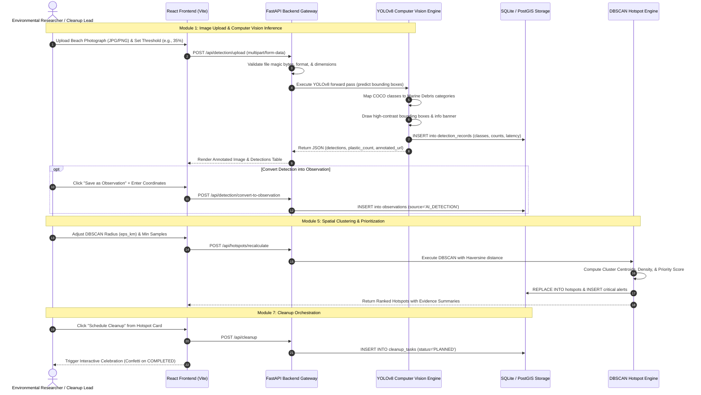

# MarineGuard AI – Data Flow Specification

## 1. End-to-End Data Ingestion and Inference Pipeline

The following sequence details how photographs and tabular ocean survey records travel from client upload through AI inference, database persistence, and spatial visualization.

## 2. Tabular Dataset Data Processing Flow

1. **Ingestion**: User uploads a CSV file via `POST /api/analytics/upload-csv`.
2. **Schema & Missingness Inspection**:
   - Computes null count and percentage per column.
   - Detects entirely empty columns.
   - Checks duplicate rows using hash comparison.
3. **Coordinate Bounds Validation**:
   - Validates latitude in $[-90.0, 90.0]$ and longitude in $[-180.0, 180.0]$.
   - Filters malformed entries while recording provenance.
4. **Data Cleaning & Standardization**:
   - Parses dates into standardized ISO datetime formats.
   - Saves cleaned dataset copy to `backend/data/cleaned/` with instant download URL.
