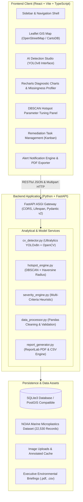

# MarineGuard AI – System Architecture & Technical Specification

## 1. High-Level Architectural Overview

MarineGuard AI employs a decoupled client-server architecture designed for high-throughput spatial query processing, deep-learning computer vision inference, and responsive geospatial map visualization.

## 2. Core Architectural Layers

### 2.1 Presentation Layer (Frontend)
- **Framework**: React 19 with Vite bundler and TypeScript.
- **Styling**: Tailwind CSS v4 with `@tailwindcss/vite` integration.
- **Visual Design**: Dark marine aesthetic (deep navy `#060b13`, cyan/teal accents, glassmorphic card overlays, customized scrollbars, and accessible typography).
- **Geospatial Rendering**: Leaflet with custom color-coded circle markers for severity levels (Emerald: Low, Amber: Medium, Orange: High, Rose: Critical).
- **Analytics Visualization**: Recharts library for bar charts, pie donuts, and historical trend timelines.

### 2.2 Application Services Layer (Backend)
- **ASGI Web Engine**: FastAPI running on Uvicorn.
- **Computer Vision Subsystem**: Ultralytics YOLOv8n single-stage neural network with OpenCV/Pillow annotation pipeline.
- **Spatial Clustering Engine**: Scikit-learn DBSCAN with Haversine spherical distance metric (radians converted using earth radius $R = 6,371\text{ km}$).
- **Transparent Severity Evaluator**: Rule-based scoring engine attributing points to concentration magnitude, marine setting sensitivity, computer vision plastic count, and observation recency.
- **Data Preprocessor**: Pandas DataFrame ingestion, coordinate bounds checks $(-90 \le \text{lat} \le 90, -180 \le \text{lon} \le 180)$, missingness analysis, and duplicate purge.
- **Report Engine**: ReportLab PDF document compilation and CSV streaming.

### 2.3 Persistence Layer
- **Relational Database**: SQLite3 with thread-safe connection pooling, row factories, and indexed spatial/severity columns.
- **Database Schema**:
  1. `observations`: Coordinate survey records, ocean basin, concentration class, severity score, verified status, and provenance tags.
  2. `detection_records`: Image metadata, detected bounding boxes JSON, confidence threshold, inference latency ms, and plastic counts.
  3. `hotspots`: Clustered geographic sectors, observation count, priority score (0-100), evidence summary, and cleanup status.
  4. `cleanup_tasks`: Actionable remediation operations, assigned teams, target deadlines, and status workflow (PLANNED -> IN_PROGRESS -> COMPLETED).
  5. `alerts`: In-app notification triggers with deduplication hashes.
