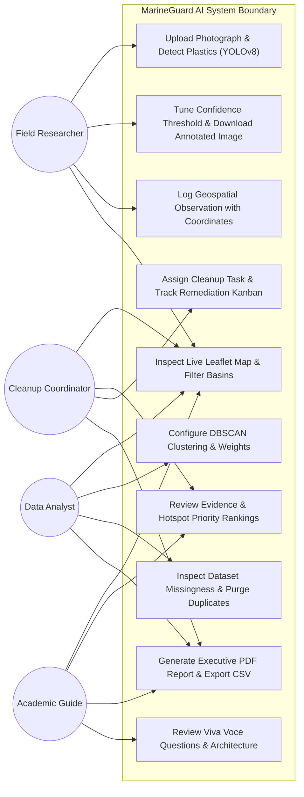

# MarineGuard AI – UML Use-Case Specification

## 1. Actor Identification
- **Field Researcher / Drone Operator**: Captures coastal and pelagic photographs, records new GPS observations, reviews AI detections.
- **Cleanup Operations Coordinator**: Evaluates prioritized hotspots, assigns response teams, schedules intervention dates, updates cleanup status.
- **Environmental Data Analyst**: Ingests external CSV datasets, analyzes missingness and duplicates, runs DBSCAN clustering parameter sweeps, exports cleaned datasets.
- **Academic Examiner / College Guide**: Audits project methodology, inspects severity formulas, verifies authentic NOAA dataset integration, reviews viva voce cheat sheet.

## 2. UML Use-Case Diagram

## 3. Detailed Use-Case Descriptions

### UC1: Upload Photograph & Run YOLOv8 Detection
- **Primary Actor**: Field Researcher / Drone Operator.
- **Preconditions**: User has access to the web interface; backend FastAPI server is operational.
- **Main Flow**:
  1. User selects a local image file (JPG, JPEG, PNG).
  2. User adjusts the confidence threshold slider (default 35%).
  3. User triggers the detection button (or selects the 1-click sample image).
  4. Server validates file format and image dimensions.
  5. YOLOv8 processes the frame, extracting bounding boxes and mapping COCO classes to marine debris categories.
  6. Annotated image is rendered with high-contrast bounding boxes, category tags, and inference latency ms.
- **Postconditions**: Detection record is stored in SQLite; user can download the annotated image or link it to a geographical coordinate.

### UC5: Configure DBSCAN Clustering & Prioritize Hotspots
- **Primary Actor**: Environmental Data Analyst.
- **Main Flow**:
  1. Analyst adjusts DBSCAN clustering radius $\epsilon$ (30 to 500 km) and minimum samples ($2$ to $25$).
  2. Analyst customizes weighting for observation density, severity index, and temporal recency.
  3. System re-runs DBSCAN with Haversine distance, identifies spatial centroids, and recalculates composite priority scores (0 to 100).
- **Postconditions**: Hotspot rankings are updated across the dashboard and critical alerts are automatically generated.
